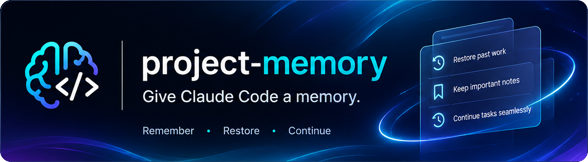

# project-memory

**Helps Claude remember your work from one conversation to the next.**

project-memory is a free add-on (a "plugin") for Claude Code. Once it's
installed, it works on its own in the background. You don't have to learn any
commands to get the benefit.


*The demo replays three real conversations in a sample project, with the
messages shortened to fit.*


## Quick start

You need Node.js 20 or newer. Git is optional: it keeps old versions of your
notes. Type these two lines in Claude Code, then restart it. When the second
line opens a menu, choose to install it for you (user scope).

```
/plugin marketplace add zdraveski/project-memory
/plugin install project-memory@project-memory
```

The [step-by-step install](#install) explains each step and what you need
first.

## What you get

Every new conversation in Claude Code starts fresh. To carry things over,
Claude Code keeps a notebook for each project (it calls this *auto memory*),
where Claude writes down your preferences, decisions and corrections.
project-memory looks after that notebook.

| Without project-memory | With project-memory |
|---|---|
| You start a new conversation and explain again where you were. | Claude starts already knowing where the last conversation stopped. |
| Work from a few weeks ago is hard to find again unless Claude wrote a note about it. | Every exchange is kept in a journal on your computer. Ask about any earlier work in your own words, and Claude searches it and answers with the date. |
| When the notebook's table of contents gets too long, Claude Code asks Claude to shorten it, and Claude decides what to merge or drop. | The table of contents is kept short for Claude, and no note is dropped. Older lines move to an archive that Claude can still search. |
| A very long conversation is shortened to a summary, and details of the task in progress can get lost. | Claude saves its notes before that happens, and afterwards it's told what you asked and what it last said. |
| A note deleted or overwritten by mistake is gone for good. | After each reply that changed a note, the note is saved to a history on your computer. Ask Claude, and it brings an old version back. |
| You teach Claude how you like to work again in every project. | Lessons that apply everywhere are shared with all your projects. |
| Two Claude windows on the same project can overwrite each other's notes. | project-memory never writes over a change another window just made, and each new conversation is told what the other windows are doing. |

It runs on its own after every reply, with no waiting you'd notice, and what
it saves stays on your computer.

## Who it's for


To weigh it against other memory tools, see
[How it compares](#how-it-compares).

## A week with project-memory

![A week with project-memory. Monday: you tell Claude the bakery's cake prices, and Claude writes them down. Tuesday: in a new conversation you ask "Where did we leave off?", and Claude already knows. Wednesday: a big task runs so long that the conversation is shortened; Claude saved its notes first and is told what it was doing, so it carries on. Thursday: a note gets deleted by mistake; you ask, and it comes back. Friday: you open a different project, and Claude already knows you like short, plain answers, because you shared that lesson with all your projects.](docs/a-week.webp)

## Long conversations and compaction

Claude has a limited amount of room for a conversation, like a desk that only
holds so many papers. Everything has to fit on it: your messages, its replies,
and everything it has read or run along the way. This room is called the
*context window*.

When a conversation nearly fills the context window, Claude Code makes room on
its own. It replaces the older part of the conversation with a short summary,
then carries on. This is called *auto-compaction*. You can also do it yourself
at any time by typing `/compact`.

A summary keeps the gist, but details get lost. Claude Code helps a little on
its own: afterwards it reloads your notes, re-reads the files Claude used most
recently, and reminds Claude of background jobs still running. But it checks
for room before every step, so it can compact in the middle of a task. The
summary may then lose the details of what you asked, what Claude had just
said, or the notes it meant to write when it finished.


project-memory protects your work before, during and after:

1. **Before.** When a conversation is about 85% full, Claude is asked once to
   write its notes, so what's worth keeping is saved before any summary is
   made. When you type `/compact` yourself, the notes are tidied and the
   record of where you are is saved first.
2. **During.** If Claude Code starts to compact in the middle of a task,
   project-memory asks it to wait until Claude finishes the step it's on.
   Waiting needs room for one more step, so it asks only while the
   conversation is between 200,000 tokens (a token is about three quarters
   of a word) and 90% of what the model can hold. Past 90%, it writes down
   what Claude is in the middle of instead. With Claude Code's usual settings
   a conversation is compacted only when it's past 90%, so this step writes
   the note and doesn't wait. To give it room to wait, see
   [Compaction](docs/how-it-works.md#compaction). Claude Code doesn't always
   agree to wait.
3. **After.** If a task is cut off anyway, Claude is told straight away what it
   was in the middle of: what you asked, what it last said, any background
   jobs still running, and the files it had changed.

### If your model holds 200,000 tokens

project-memory can't tell which model you use, so it assumes a context window
of 1,000,000 tokens. With a 200,000-token model, the reminder at 85% never
comes, and the "During" step never runs, since the conversation never passes
200,000 tokens.

Not sure which you have? Ask Claude: *"Is my context window 200,000
tokens?"* If it is, ask: *"Add CLAUDE_CODE_AUTO_COMPACT_WINDOW set to 200k
under env in my Claude Code settings,"* then restart Claude Code. If you later
switch to a model with a bigger window, ask Claude to remove that setting, or
Claude Code will keep shortening conversations at 200,000 tokens.

If you chose a size with `/autocompact`, ask for that size instead of 200k:
project-memory can't see the size you chose there. The details are under
[Compaction](docs/how-it-works.md#compaction).

## Good to know

![Good to know, at a glance. Your existing notes: older lines may move to the archive, and no note is deleted. How much room it takes: a short briefing, usually under 1,000 tokens, about 0.5% of a 200,000-token window. Where it works: Windows, macOS and Linux, wherever Claude Code can find Node.js. One computer: notes stay on the computer they were made on and don't sync. Repositories: subfolders and worktrees of a git repository use its notebook. Your own files: it writes only inside Claude Code's own folder, never in your project.](docs/good-to-know.webp)

- **Your existing notes.** The first time it runs, project-memory may move
  older lines from the table of contents to the archive. No note is deleted,
  Claude can still find those notes, and if Git is installed, the first copy
  in the history keeps the table of contents as it was.
- **How much room it takes.** project-memory is free. Each conversation
  starts with a short briefing for Claude, which you don't normally see,
  usually under 1,000 tokens: about half a percent of a 200,000-token context
  window. After a compaction it also repeats the latest exchanges, and stays
  under about 2,500 tokens. In return, the table of contents Claude reads at
  every start is kept small ([the numbers](docs/how-it-works.md#the-index)).
  The journal isn't loaded at the start: the briefing has one line saying
  it's there.
- **Disk space.** Each exchange adds one entry to the journal, in plain text
  files you can read. On the author's computer, half the entries are under
  3 KB and the largest is about 15 KB. The busiest project there wrote about
  115 KB a day: about 40 MB in a year if you worked on it every day.
- **Where it works.** On Windows, macOS and Linux, wherever Claude Code runs on
  your computer and can find Node.js.
- **One computer.** Your notes and their history stay on the computer they
  were made on. They don't sync to your other computers.
- **Repositories.** A conversation started in a subfolder or a worktree of a
  git repository uses that repository's notebook, as Claude Code does. When
  a worktree's folder is outside the repository's folder, the journal takes
  in its older conversations once Claude has finished a reply there.
- **If you turn off auto memory.** While `CLAUDE_CODE_DISABLE_AUTO_MEMORY` is
  set to `1`, `true`, `yes` or `on`, project-memory does nothing on its own
  except note the conversation's short tag when it starts and after every
  reply, so the journal never takes it in later, not even if you go on with
  it after turning auto memory back on.
  Only the memory skill still works when you ask for it. If you turn
  auto memory off with `/memory` instead, project-memory can't see that,
  because it doesn't read your settings:
  [turn it off](#turning-it-off-or-removing-it) as well. When you turn it
  back on, the journal takes in the conversations you held meanwhile, if
  Claude Code still keeps them. Type `<private-session>` in any you want left
  out.
- **Your own files.** project-memory only writes inside Claude Code's own
  folder. It never touches your project's files or your own git repositories.
  If you made Claude Code's projects folder into a git repository yourself,
  project-memory leaves it alone and keeps no history there.

## Before you install


If one is missing, download it from [nodejs.org](https://nodejs.org) (choose
the LTS version) or [git-scm.com](https://git-scm.com).

## Install


1. In Claude Code, type this line and press Enter:

   ```
   /plugin marketplace add zdraveski/project-memory
   ```

2. Then type this one and press Enter. In the menu that opens, choose to
   install it for you (user scope), so it works in every project:

   ```
   /plugin install project-memory@project-memory
   ```

3. Close Claude Code and open it again.

4. Check that it's working by typing:

   ```
   /project-memory:memory doctor
   ```

   Every line should start with `ok`. Until Claude finishes its first reply,
   one of them says it's waiting for that reply, which is normal. A line that
   starts with `PROBLEM` says what to do about it. See
   [If something seems wrong](#if-something-seems-wrong).

## Using it day to day

![Nothing to learn. Just ask. Keep working as you always have. "Remember that I prefer short answers": Claude saves a note. "Where did we leave off?": Claude reads the record of your last conversation. "Did we decide anything about the logo?": Claude searches your notes, including the archive. "I deleted the note about pricing by mistake. Can you bring it back?": Claude restores it from the history. "Remember for all my projects that I like plain language": Claude saves it straight to the shared notebook.](docs/day-to-day.webp)

When you want something from your notes or your earlier work, just ask in
your own words:

| You say | What happens |
|---|---|
| *"Remember that I prefer short answers."* | Claude saves a note. |
| *"Where did we leave off?"* | Claude reads the record of your last conversation. |
| *"What did we decide about the logo in September?"* | Claude searches your notes, the archive and the journal, and answers with the date. |
| *"What did I work on last week?"* | Claude lists what you asked each day last week, from the journal. |
| *"Show me exactly what you answered about the logo."* | Claude finds the journal entry and reads all of it. |
| *"Forget the password I pasted yesterday."* | Claude lists the journal entries that match, and removes the ones you confirm. |
| *"I deleted the note about pricing by mistake. Can you bring it back?"* | Claude restores it from the history. |
| *"Make the note about short answers apply to all my projects."* | Claude asks you to confirm, then moves it to the shared notebook. |
| *"Remember for all my projects that I like plain language."* | Claude saves it straight to the shared notebook. |
| *"We changed how we ship. Replace the old note."* | Claude writes a new note and marks the old one as replaced. The old note moves to the archive and points to the new one. |

If you'd rather type a command, these do the same things:

| Type | What it does |
|---|---|
| `/project-memory:memory status` | A quick health check of this project's notes, and which notes were added, changed or deleted this week |
| `/project-memory:memory search logo colors` | Finds notes and journal entries about "logo colors", with the lines around those words |
| `/project-memory:memory show 'key'` | Shows one journal entry in full, by the key `search` printed |
| `/project-memory:memory forget password` | Lists the journal entries that mention "password", each with its key, and removes the ones you confirm |
| `/project-memory:memory history pricing` | Shows when the note called "pricing" changed |
| `/project-memory:memory restore pricing` | Brings back the note called "pricing" |
| `/project-memory:memory promote pricing` | Moves the note called "pricing" to the shared notebook |
| `/project-memory:memory doctor` | Checks that project-memory is set up and running |

A note's name is the name of its file, without the `.md` ending. `search`
shows them, and the key of each journal entry it finds.

To read your notes yourself, type `/memory` in Claude Code and open the auto
memory folder. The record of where you left off is the file `handoff.md` in
that folder, and the journal is its `journal` folder, one file per day. To
keep a message or a whole conversation out of both, see
[Your privacy](#your-privacy).

## Updating

In a terminal (Terminal on a Mac, PowerShell on Windows), run these two
commands, then restart Claude Code:

```
claude plugin marketplace update project-memory
claude plugin update project-memory@project-memory
```

These go in a terminal, not in the Claude Code chat. You can also ask Claude:
*"Run these two commands for me,"* then restart Claude Code. What changed in
each version is in the [changelog](CHANGELOG.md).

## If something seems wrong

**Claude doesn't remember the last conversation.** Ask *"Where did we leave
off?"* If Claude still doesn't know, type `/project-memory:memory doctor`.

**The check says "not installed".** project-memory isn't installed, and it
has never run. If you added it on claude.ai instead of with the commands
above, let Claude finish one reply and run the check again. Otherwise, go
through the [Install](#install) steps again.

**The check says "the Stop hook ran twice for one reply".** project-memory's
hooks are set up twice, so everything it does happens twice. Either its hooks
were also added to your Claude Code settings by hand at some point, or a
second copy is installed under another name. Ask Claude: *"Remove the
project-memory hooks from my settings, and uninstall any second copy of
project-memory. Keep the plugin."*

**Claude says "Memory hooks look stopped".** Each conversation starts with a
short briefing for Claude, which you don't normally see, and this line in it
means another conversation in this project finished a reply after
project-memory last saved. If you had
turned project-memory off for a while, this goes away after the next reply. If
not, type `/project-memory:memory doctor`.

**The check says "snapshots: off".** Git isn't installed, or Claude Code's
projects folder is a git repository you made yourself. Everything works except
bringing back an old version of a note. To turn the history on, install Git,
or move your own repository out of that folder.

**The check says "its Stop hook is not running".** Claude finished a reply,
but project-memory didn't save after it. Restart Claude Code. If the line is
still there after Claude's next reply, ask Claude to check that Node.js is
installed.

**Any other line that starts with `PROBLEM`.** Most of these lines end with
what to do. If it's unclear, ask Claude: *"What does this line mean, and how
do I fix it?"*

**A note seems to be gone.** It may have moved to the archive, where it's still
kept. Ask Claude to search for it. If it was deleted, ask Claude to bring it
back.

**"node" is not found.** Install Node.js (see
[Before you install](#before-you-install)), then restart Claude Code.

## Your privacy

![What it saves stays on your computer. It never goes online: everything it saves stays in Claude Code's own folder on your computer. Common secrets are blanked out: keys, tokens and passwords you paste become [redacted] before anything is saved. Keep part of a message out: put it between <private> and </private>, and it isn't saved. Keep a whole conversation out: type <private-session> in any message. Claude still sees what you write, and your conversation goes to Anthropic as usual.](docs/privacy.webp)

- project-memory never connects to the internet. What it saves stays on your
  computer, in Claude Code's own folder (`.claude`, in your home folder).
- Claude reads your notes, and the journal entries it searches for, during
  your conversations, as it does with Claude Code's built-in memory. What
  project-memory adds to a conversation, such as the briefing at its start,
  goes to Anthropic with the rest of the conversation.
- The record of where you left off includes the start of your messages and of
  Claude's replies, and the names of the files Claude changed. It's kept only
  until newer exchanges replace it, and since version 1.1.0 it's not part of
  the history (the privacy policy says how to remove older copies). The
  history keeps old versions of your notes and the journal's finished days.
  If you copy or share your `.claude` folder, all of that goes with it, the
  journal too.
- The journal keeps every exchange: your message (up to 2,000 characters),
  Claude's reply (up to 6,000: of a longer one, its first 4,000 and its last
  2,000), the paths of up to 20 files Claude changed, and the last 20
  commands it ran (up to 400 characters each). It's in
  the `journal` folder of each project's notebook, one file per day, with a
  file `journal.md` beside it. It stays until you delete it or ask Claude to
  forget part of it. It isn't loaded when a conversation starts: the briefing
  only says, in one line, that it's there.
- After every reply, the journal also takes in any of the project's
  conversations it hasn't read yet, if Claude Code still keeps them (by
  default, those used in the last 30 days), however long they are. On a new
  install that's about the last month. After a pause, it's the conversations
  you held while project-memory was turned off. It leaves out conversations
  marked `<private-session>`, even if you typed it while project-memory was
  off, and those held while auto memory was turned off with
  `CLAUDE_CODE_DISABLE_AUTO_MEMORY`. It can tell that only for conversations
  held while this version was installed and on: one held with auto memory
  off at another time is taken in.
- Once a day is over, its journal file goes into the history. Removing an
  entry later, by asking Claude to forget it or with `<private-session>`,
  takes it out of the journal but not out of the history of an earlier day.
  To remove those copies too, delete the history (the privacy policy says
  how).
- To remove something from the journal, ask Claude, for example *"Forget the
  password I pasted yesterday."* Claude lists the entries that match, and
  removes exactly the ones you confirm, in one project at a time. They go
  from the record of where you left off too, so the next briefing doesn't
  show them; Claude Code's own conversation files are separate. The exchanges in which Claude
  looks for what to forget and removes it are kept without their words, in
  the journal and in the record of where you left off, so what was removed
  isn't saved again. To empty the journal, ask Claude to forget everything
  in it: you confirm the dates it covers and how many entries go, not each
  entry. That removes only what the journal holds so far: if `status` shows
  conversations still to import, ask again once they're in.
- Common kinds of keys, tokens and passwords are replaced with `[redacted]`
  before anything is saved, whether you paste them into a message or Claude
  passes them to a command: API keys, access tokens, passwords in web
  addresses, settings such as `password=`, and options such as `--password`
  or `export API_TOKEN=`. A name that stands for a secret, such as
  `$API_TOKEN`, a file's path and a count stay, so a search still finds the
  command. No tool can recognize every secret, so use `<private>` for
  anything else.
- To keep something out, put it between `<private>` and `</private>`. That
  part isn't saved. Claude's reply to that message isn't saved either, since a
  reply often repeats what it was told, and neither are the names of the files
  changed in that turn. The tags work in any letter case, and in a message you
  type while Claude is still working. A later reply that repeats the private
  part is saved like any other, so if it will come up again, use
  `<private-session>`. The tags keep text out of project-memory's own files
  only: Claude still sees it, Claude Code still keeps it in its own
  conversation files, and if Claude writes it into a note, the history keeps
  that note.
- To keep a whole conversation out of the record and the journal, type
  `<private-session>` in any message, early or late. What was saved before
  is removed from both, and Claude isn't asked to write notes before the
  conversation is shortened. Claude can still write notes in that
  conversation if you ask it to.

The full details are in the [privacy policy](PRIVACY.md).

## Turning it off or removing it

To pause it, run this in a terminal (or ask Claude to run it) and restart
Claude Code. Your notes and their history stay as they are.

```
claude plugin disable project-memory@project-memory
```

`claude plugin enable project-memory@project-memory` turns it back on. The
journal then takes in the conversations you held while it was off, if Claude
Code still keeps them. To keep one out, type `<private-session>` in it. If
you added project-memory from claude.ai, turn it off or remove it with
`/plugin` in Claude Code instead.

To remove it, type this in Claude Code:

```
/plugin uninstall project-memory@project-memory
```

Your notes and the journal stay where they are, and Claude Code keeps using
the notes. To delete the journal, delete the `journal` folder and the file
`journal.md` in each project's `memory` folder, and the line that points to
`journal.md` in that folder's `MEMORY.md`. To delete the history of your
notes as well, delete the hidden folder `.git` inside `.claude/projects` in
your home folder, or ask Claude to. A few small files project-memory kept for
itself stay too, and you can delete them: in `.claude/projects`,
`.gitignore`, `.stop-ran`, `.snapshot-health`, `.memory-off`, any
`.handoff-failed-…` file and the folder `.nudge`; in each project's `memory`
folder, `.tiered`, `.health` and `.private-sessions`.

## How it compares

Claude Code's own memory keeps improving. It now asks Claude to shorten the
table of contents when it nears its limit, and after a compaction it reloads
your notes, re-reads recent files and reminds Claude of jobs still running.
project-memory adds what it still doesn't do: a new conversation that starts
knowing where the last one stopped, a journal of every exchange that Claude
searches when you ask about earlier work, a history of every note, a shared
notebook for all your projects, and safe use of several windows at once.

project-memory isn't the only add-on either. This table compares it with five
popular tools, going only by each one's own documentation on 27 October 2026.
"Not stated" means that documentation doesn't say. These tools change often,
so check their pages before you choose.

| | project-memory | [claude-mem](https://github.com/thedotmack/claude-mem) | [Mem0](https://docs.mem0.ai/integrations/claude-code) | [Supermemory](https://github.com/supermemoryai/claude-supermemory) | [Basic Memory](https://github.com/basicmachines-co/basic-memory) | [context-mode](https://github.com/mksglu/context-mode) |
|---|---|---|---|---|---|---|
| What it is | Claude Code plugin | Claude Code plugin | Claude Code plugin | Claude Code plugin | Memory server for many AI apps | Claude Code plugin |
| Main job | Looking after Claude Code's own memory | Recording and summarising sessions | Memory in the cloud | Memory in the cloud | A knowledge base of notes | Saving context window space |
| Where your memories live | Claude Code's own notebook, on your computer | Its own database, on your computer | Mem0's servers | Supermemory's servers | Text files on your computer, or a paid cloud | A database on your computer, cleared after 14 days |
| Account or API key | No | Optional | Required | Required | No, unless you use the paid cloud | No |
| Extra software | Node.js and Git | Node.js, Bun, uv and a background service | Python and Git | Node.js | Python | Node.js |
| Uses an AI model to write memories | No | Yes: your Claude plan, your own key, or its paid service | Yes, on Mem0's side | Yes, on Supermemory's side | No | No |
| How memories are made | Claude writes notes, and every exchange is saved to a journal after every reply | Automatically, from everything Claude does | Automatically, from your conversations | Automatically, from your conversations | Claude writes notes when asked | Automatically, from what happens in a session |
| Search | By words | By words and by meaning | By meaning | By meaning | By words and by meaning, plus links between notes | By words |
| Picks up where you left off | Yes | Yes | Brings back up to 5 memories at the start | Searches memory on every message | When Claude reads the notes | Yes |
| Protects work when a conversation is compacted | Before, during and after | Not stated | Not stated | Not stated | Not stated | Yes |
| Old versions kept, so you can undo | Yes, of notes and of each finished day of the journal | Not stated | Not stated | Not stated | Paid cloud only | No |
| Lessons shared across your projects | Yes | Not stated | No, kept per repository | A personal profile | Yes, one knowledge base | Search across projects |
| Shared with a team | No | Optional | Yes | Yes | Not stated | No |
| Safe with several windows open | Yes, and each window is told about the others | Not stated | Not stated | Not stated | Not stated | Not stated |
| Sends your data anywhere | No | To the AI service you pick | To Mem0, plus usage data tied to your account | To Supermemory | No, unless you use the paid cloud | No |
| Works outside Claude Code | No | Yes | Through other Mem0 integrations | Shares memory with Codex and OpenCode | Yes: Claude Desktop, Cursor, ChatGPT, Obsidian and more | Yes |
| License | MIT | Apache-2.0 | Apache-2.0 | MIT | AGPL-3.0 | Elastic License 2.0 |

In plain words:

- **project-memory** suits you if you want Claude Code's own memory kept
  tidy, safe from mistakes and intact through long conversations, with nothing
  to sign up for and nothing leaving your computer. It keeps a journal of
  every exchange for Claude to search. It searches by words only, works in
  Claude Code only, and doesn't sync between computers or teammates.
- **claude-mem** records everything Claude does and searches it by meaning. It
  runs a background service, and an AI model writes its summaries, which uses
  your Claude plan, your own key or its paid service.
- **Mem0** and **Supermemory** keep memory in the cloud, so it can be shared
  with a team and with other tools. Both need an account, and your
  conversations are sent to their servers.
- **Basic Memory** builds a knowledge base of readable text files that many AI
  apps can use. Claude adds notes when you ask it to, rather than on its own.
- **context-mode** mainly keeps long tool output out of the context window.
  Its session memory is a bonus. It does a different job, and it runs fine
  alongside project-memory.

Two more are worth knowing about:

- **[memory-toolkit](https://github.com/IlyaGorsky/memory-toolkit)** is a
  Claude Code plugin that works on the same notebook. It sorts your work into
  "workstreams", each with its own record of where you left off. It also logs
  your git commits into daily notes, and before a compaction it notes your
  branch and the changes you haven't committed yet. Every few minutes it
  sends the latest part of the conversation to Claude's small Haiku model,
  which picks out corrections, decisions and plans.
- **[MemPalace](https://github.com/MemPalace/mempalace)** keeps your
  conversations word for word and searches them by meaning, without calling
  any online service. It needs Python, keeps everything in its own database,
  and Claude reaches it as an MCP server (a tool Claude can call).

## Words used here

- **Conversation**: one session with Claude, from when you start it until you
  close or clear it.
- **Note**: a short file where Claude writes down something worth keeping.
  Claude Code calls these *memories*.
- **Notebook**: all of one project's notes, with their table of contents (a
  file called `MEMORY.md`).
- **Archive**: where older lines from the table of contents go. Claude doesn't
  read it at the start of every conversation, but it can search it.
- **Record of where you left off**: the file `handoff.md` in each notebook. It
  holds the start of your latest messages and Claude's replies, and the files
  Claude changed, so the next conversation can pick up from there.
- **Journal**: the `journal` folder in each notebook, one file per day, where
  project-memory keeps every exchange: what you asked, Claude's reply, the
  files it changed and the commands it ran. Claude searches it when you ask
  about earlier work.
- **Briefing**: a short note project-memory gives Claude when a conversation
  starts, after `/clear` and after a compaction: where things stopped, what
  other windows on the project are doing, that the journal is there, the
  shared notebook's table of contents, and anything that needs fixing. You
  don't normally see it.
- **Shared notebook**: notes that apply to all your projects. In every
  project, Claude is shown its table of contents when a conversation starts,
  after `/clear` and after a compaction. A conversation you resume already
  has it from when it began. That table of contents is kept small (3 KB), so
  when it fills up, the oldest shared lessons move to its archive and are no
  longer shown everywhere, unless they're marked to stay.
- **History**: your notes as they were after each reply that changed them,
  and each finished day of the journal, kept with Git on your computer, so an
  old version of a note can be brought back.
- **Project**: the folder you open Claude Code in.
- **Context window**: how much of a conversation Claude can keep in view at
  once. Its size is counted in tokens, about three quarters of a word each.
- **Compaction** (or shortening): what Claude Code does when a conversation
  nearly fills the context window. It replaces the older part with a summary.
  When Claude Code does it on its own, it's called *auto-compaction*.
- **Plugin**: an add-on for Claude Code.
- **Terminal**: the app where you type commands: Terminal on a Mac, PowerShell
  on Windows.

## More

- [How it works](docs/how-it-works.md): the technical details, for the curious.
- [Changelog](CHANGELOG.md): what changed in each version.
- [Privacy policy](PRIVACY.md): what it reads and saves, in full.
- [Contributing](CONTRIBUTING.md): running the tests and changing the code.
- Questions or problems: [open an issue](https://github.com/zdraveski/project-memory/issues).
- License: [MIT](LICENSE). Free to use, change and share.
