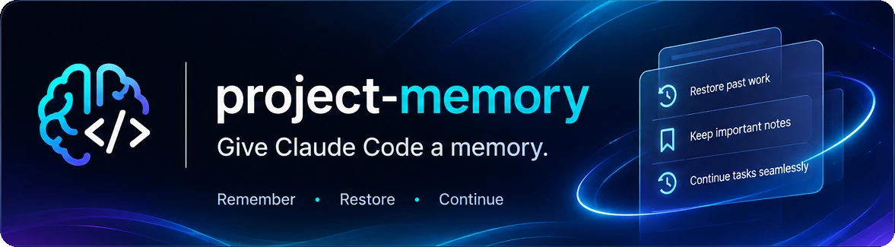
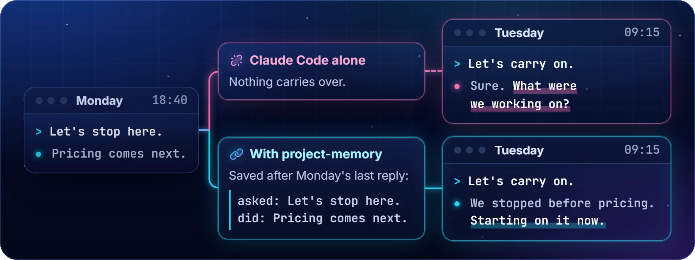
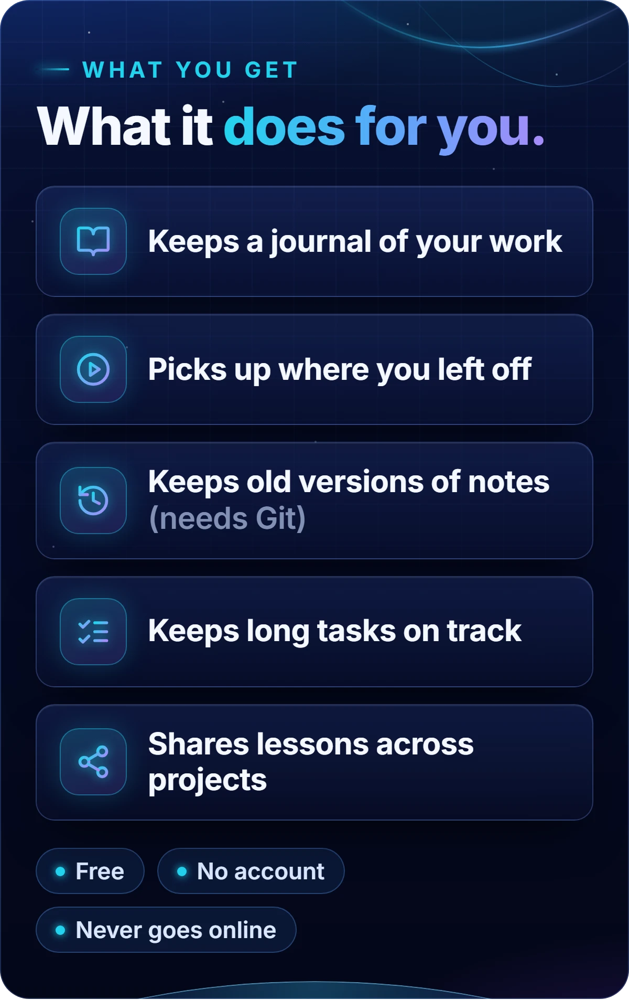
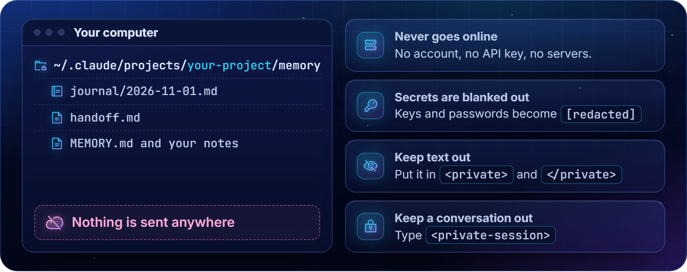
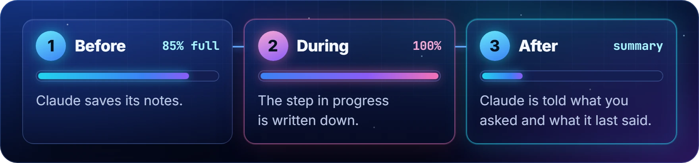

<p><picture>
  <source media="(max-width: 700px)" srcset="docs/banner-narrow.webp">
  
</picture></p>

# project-memory

[](https://github.com/zdraveski/project-memory/actions/workflows/test.yml)
[](https://github.com/zdraveski/project-memory/releases/latest)
[](LICENSE)
[](#install)
[](https://scorecard.dev/viewer/?uri=github.com/zdraveski/project-memory)
[](https://www.bestpractices.dev/projects/16158)
[](https://www.bestpractices.dev/projects/16158/baseline-2)

**It remembers everything so you never lose your work and your ideas.**

It leaves out incognito conversations, `<private>` text and secrets.

project-memory is a free add-on (a "plugin") for Claude Code. It works on its
own after every reply, keeps everything on your computer, and needs no
account or API key.

To try it, type these two lines in Claude Code. When the second one opens a
menu, choose to install it for you (user scope), then restart Claude Code. It
needs Node.js 22 or newer; the full steps are under [Install](#install).

```
/plugin marketplace add zdraveski/project-memory
/plugin install project-memory@project-memory
```

[Install](#install) · [Using it](#using-it) · [Privacy](#your-privacy) ·
[Questions](docs/faq.md) ·
[Project page](https://zdraveski.github.io/project-memory/)

<p><picture>
  <source media="(max-width: 700px)" srcset="docs/problem-narrow.webp">
  
</picture></p>

## What you get

Claude Code keeps a notebook of notes for each project (it calls this *auto
memory*). project-memory looks after that notebook and adds a journal of
everything you did.

| Without project-memory | With project-memory |
|---|---|
| Work from a few weeks ago is hard to find again. | Every exchange is kept in a journal on your computer. Ask about earlier work in your own words, and Claude finds it and tells you when it happened. |
| Each new conversation starts from zero. | Claude starts already knowing where the last conversation stopped. |
| A note deleted or overwritten by mistake is gone. | Every version of your notes is kept, and Claude brings an old one back when you ask. |
| A long conversation is cut down to a summary, and the task in progress can get lost. | Claude saves its notes first, and afterwards it's told what you asked and what it last said. |
| You teach Claude your habits again in every project. | Lessons that apply everywhere are shared with all your projects. |

It also keeps the notebook's table of contents short without dropping a note,
and lets two Claude windows on one project work without overwriting each
other. It helps most when you come back to the same project over days or
weeks. For a quick one-off question, you won't notice much difference.

<p><picture>
  <source media="(max-width: 700px)" srcset="docs/what-you-get-narrow.webp">
  
</picture></p>

## Install

You need Claude Code with its built-in memory on (it is, unless you turned it
off) and [Node.js](https://nodejs.org) 22 or newer (choose the LTS version).
[Git](https://git-scm.com) is optional: without it, everything works except
bringing back old versions of notes. Not sure? Ask Claude: *"Do I have
Node.js 22 or newer, and Git?"*

1. In Claude Code, type these two lines. When the second one opens a menu,
   choose to install it for you (user scope), so it works in every project.

   ```
   /plugin marketplace add zdraveski/project-memory
   /plugin install project-memory@project-memory
   ```

2. Close Claude Code and open it again.
3. Type `/project-memory:memory doctor`. Every line should start with `ok`.
   Until Claude finishes its first reply, one line says it's waiting for
   that reply, which is normal.

## Using it

There's nothing to learn. Ask in your own words:

| You say | What happens |
|---|---|
| *"What did we decide about the logo in September?"* | Claude searches your notes and the journal, and answers with the date. |
| *"What did I work on last week?"* | Claude lists what you asked each day, from the journal. |
| *"Where did we leave off?"* | Claude already knows: each new conversation starts with the last one's latest exchanges, as many as fit in a short briefing. For more, it reads the record of your last conversation. |
| *"Remember that I prefer short answers."* | Claude saves a note. |
| *"I deleted the note about pricing by mistake. Bring it back."* | Claude restores it from the history. |
| *"Forget the password I pasted yesterday."* | Claude lists the journal entries that match, and removes the ones you confirm from project-memory's files. Claude Code's own conversation files still hold them. |
| *"Remember for all my projects that I like plain language."* | Claude saves it to the shared notebook. |

If you'd rather type a command, start with `/project-memory:memory`:

| Type after it | What it does |
|---|---|
| `search logo colors` | Finds notes and journal entries about "logo colors". An entry shows as a short headline: what you asked, how it ended, and the lines with your words |
| `show 'key'` | Shows one journal entry in full, by the key `search` printed |
| `forget password` | Lists the journal entries that mention "password" and removes the ones you confirm (Claude Code's own conversation files still hold them) |
| `history pricing` / `restore pricing` | Shows when the note "pricing" changed / brings it back |
| `promote pricing` | Moves the note "pricing" to the shared notebook |
| `status` / `doctor` | A health check of this project's notes / of project-memory itself |

To read your notes yourself, type `/memory` in Claude Code and open the auto
memory folder. The journal is its `journal` folder, one file per day.

## Your privacy

<p><picture>
  <source media="(max-width: 700px)" srcset="docs/privacy-narrow.webp">
  
</picture></p>

- project-memory never goes online. What it saves stays in Claude Code's own
  folder (`.claude`, in your home folder). What Claude reads during a
  conversation goes to Anthropic with the rest of it, as with Claude Code's
  own memory.
- The journal keeps each exchange whole: your message, Claude's reply, every
  file it changed and every command it ran. It stays until
  you delete it or ask Claude to forget part of it.
- Keys, tokens and passwords are replaced with `[redacted]` before anything
  is saved. No tool catches every secret, so use the tags below for anything
  else.
- Put text between `<private>` and `</private>` to keep it out. Type
  `<private-session>` in any message to keep the whole conversation out; what
  was saved of it before is removed, except the history's copy of days that
  are already over.
- *"Forget …"* removes the journal entries you confirm. For days that are
  already over, a copy stays in the history until you delete the history.

Everything it reads and saves, and how to delete it, is in the
[privacy policy](PRIVACY.md).

## Security and trust

- **Every change is checked.** It reaches the code only as a pull request
  that passes the tests on Windows, macOS and Linux and a sign-off check.
  GitHub's CodeQL scan and OpenSSF Scorecard run every week. Before each
  release the changes get one code review, and what it finds is fixed.
- **Releases can be verified.** From 1.2.4, each release carries its files,
  their checksums and a GitHub-signed record of where they were built:
  [Verifying a release](SECURITY.md#verifying-a-release).
- **The risks are written down.** What could go wrong, and what guards
  against it: [Security assessment](docs/security-assessment.md).
- **A security or privacy problem?** Report it privately, as
  [SECURITY.md](SECURITY.md) says. You get an answer within a week.

## Good to know

- **Room.** Each conversation starts with a short briefing for Claude. The last
  conversation's exchanges fill it up to 3,500 characters (at most 3,499 on 13
  real projects). A long list of shared lessons or warnings can pass that, but
  never 9,500. After a compaction it is larger: 8,481 characters at the median
  and 9,366 at most on 8 projects, never over 9,500. The journal isn't loaded,
  only searched when needed.
- **Disk space.** The journal keeps each exchange whole, so an entry is as
  long as what was said: half are under about 5 KB, and one in a hundred is
  over about 60 KB. A very busy project adds up to about 110 MB a year.
- **Your notes.** The first run may move older lines of the table of contents
  to an archive. The plugin deletes no note (Claude Code's own cleanup might),
  and Claude can still search them.
- **MEMORY.md is the plugin's to tidy.** It rewrites the file as a plain file in
  place (so a link to it becomes a copy) and keeps the lines, not your `##`
  headings. Put what you want kept in a note, not in the headings.
- **Where.** Windows, macOS and Linux. Notes stay on the computer they were
  made on, and don't sync. Don't sync the memory folder yourself (Dropbox,
  OneDrive): each computer would undo the other's *"forget"*.
- **A moved memory folder.** The Claude Code setting `autoMemoryDirectory` is
  not followed: notes in the moved folder are not tidied, snapshotted or
  briefed. `doctor` warns when it is set.
- **Your files.** It writes only inside Claude Code's own folder, never in
  your project.

## Checked lessons

A note can carry a rule that a computer checks on a git command. Add an `enforce:` block to the note's front matter, indented two spaces:

```
enforce:
  on: git add
  has: [-A, --all, .]
  unless: [mktemp, init]
```

`on` is `git <subcommand>`. `has` is one word or up to 8 (a command matches when it has one of them as a whole word). `unless` is optional: if any of its words is in the same command, the rule does not match. Words are exact and case-sensitive.

Try the rule before you trust it: `memory enforce replay <note>` lists what it would have caught in the last 30 days of this project's conversations (sub-agents included); `--all` reads every project, and can take about a minute on 2.7 GB of history. It reads only; read each hit yourself, because a hit is a catch only if you agree the command broke the lesson.

Few lessons fit this form. Of 115 feedback notes in one real store, about 1 can be written as a git rule. This is a test of the idea, not a promise. What a rule does not see:

- `$(...)` inside quotes, `bash -c "git add -A"`, and words after `--` (`git add -- -A`); git aliases and scripts; joined short flags (`-Av`); `&` alone as a separator, `#` comments, and a rule with `unless:` words that a comment holds. Replay skips private sessions and projects with memory off.

## Long conversations

When a conversation fills up, Claude Code shortens it to a summary, and the
details of a task in progress can get lost. project-memory has Claude save
its notes before that and afterwards tells Claude what you asked and what it
last said. It can also ask Claude Code to let Claude finish the step it's on,
but only if you set `CLAUDE_CODE_AUTO_COMPACT_WINDOW` below your model's
window ([how](docs/how-it-works.md#compaction)); with the default settings
there is no room left to wait.

<p><picture>
  <source media="(max-width: 700px)" srcset="docs/long-conversations-narrow.webp">
  
</picture></p>

**If your model holds 200,000 tokens,** the reminder to save notes never
comes, because project-memory assumes 1,000,000. Ask Claude: *"Is my context
window 200,000 tokens?"* If it is, ask: *"Add CLAUDE_CODE_AUTO_COMPACT_WINDOW
set to 200k under env in my Claude Code settings,"* then restart Claude Code.
The details are under [Compaction](docs/how-it-works.md#compaction).

## Updating

In a terminal (Terminal on a Mac, PowerShell on Windows), run these two
commands, or ask Claude to run them, then restart Claude Code:

```
claude plugin marketplace update project-memory
claude plugin update project-memory@project-memory
```

What changed in each version is in the [changelog](CHANGELOG.md). Only the
newest version gets fixes, so update when a new one comes out
([Supported versions](SECURITY.md#supported-versions)).

## Turning it off

Four ways, from narrowest to widest. None of them reaches Claude Code's own
files: Claude Code by default still keeps its own transcript of every
conversation (30 days unless you change that), and its own auto memory may
still save notes. Those are Claude Code's settings, not project-memory's.

- **One conversation:** type `/project-memory:incognito`. It stops saving that
  conversation and sweeps what it already saved from the journal and
  `handoff.md`; snapshots of days already over keep a copy. It holds if you
  resume the conversation; `/clear` starts a new one, so run it again there.
  If it says `NOT applied`, it did not work.
- **One project:** `/project-memory:memory-off`, and `/project-memory:memory-on`
  to come back. While it's off, project-memory adds nothing to that project's
  journal, handoff or history, and doesn't tidy its notes; the startup says it
  is off. What you say meanwhile stays out after it's back on, and the same
  conversation's turns before and after are kept. Claude can still write a note
  if you ask. Off stops adding; it doesn't hide: search and show still answer
  from what is there.
- **All projects, this machine:** set `CLAUDE_CODE_DISABLE_AUTO_MEMORY`, or
  disable the plugin with `enabledPlugins` in your Claude Code settings.
- **Claude Code itself:** `autoMemoryEnabled: false` stops its auto memory,
  `CLAUDE_CODE_SKIP_PROMPT_HISTORY` its transcripts (with none, the journal
  records nothing either), and `claude purge` deletes what it keeps.
  project-memory does not read or change any of these.

## Pausing or removing it

To pause it everywhere, run `claude plugin disable project-memory@project-memory` in a
terminal and restart Claude Code; `enable` turns it back on. To remove it,
type `/plugin uninstall project-memory@project-memory` in Claude Code. If you
added it from claude.ai, use `/plugin` in Claude Code for both.

Your notes, the journal and the history stay either way, and so do the lines
project-memory added to each `MEMORY.md`: the ones pointing at `handoff.md`
and `journal.md` keep being loaded, so delete them when you remove it. The
privacy policy lists what to delete by hand:
[Deleting it](PRIVACY.md#deleting-it).

## If something seems wrong

Type `/project-memory:memory doctor`. A line that starts with `PROBLEM` says
what to do. If it's unclear, ask Claude: *"What does this line mean, and how
do I fix it?"*

- **Claude doesn't remember the last conversation.** Ask *"Where did we leave
  off?"*, then run the check.
- **A note seems to be gone.** It may have moved to the archive. Ask Claude to
  search for it, or to bring it back.
- **"node" is not found.** Install Node.js, then restart Claude Code.

What each message means:
[When something seems wrong](docs/how-it-works.md#when-something-seems-wrong).

## Compared with other tools

Claude Code's own memory doesn't keep a journal, a history of your notes or a
shared notebook, and doesn't keep two windows from overwriting each other.
project-memory adds those, with no account and nothing leaving your
computer. It searches by words, not by meaning, and works in Claude Code
only. The side-by-side with claude-mem, Mem0, Supermemory, Basic Memory,
context-mode and two more is in [Comparison](docs/comparison.md).

## More

- [Project page](https://zdraveski.github.io/project-memory/): the short
  tour.
- [Questions people ask](docs/faq.md): short answers.
- [How it works](docs/how-it-works.md): the technical details.
- [Changelog](CHANGELOG.md): what changed in each version.
- [Privacy policy](PRIVACY.md): what it reads and saves, in full.
- [Contributing](CONTRIBUTING.md): running the tests and changing the code.
  Changes come as pull requests, and each commit is signed off
  (`git commit -s`).
- [Governance](GOVERNANCE.md): who maintains it and how decisions are made.
- [Security assessment](docs/security-assessment.md): the threats, and what
  guards against them.
- A question: ask in
  [Discussions](https://github.com/zdraveski/project-memory/discussions).
  A problem: [open an issue](https://github.com/zdraveski/project-memory/issues).
  A security or privacy problem: report it privately, as
  [SECURITY.md](SECURITY.md) says. Where to ask what: [Support](SUPPORT.md).
- License: [MIT](LICENSE). Free to use, change and share.
- From the same author: [claude-juice](https://github.com/zdraveski/claude-juice)
  shows your Claude Code usage limits as batteries in the status line.
