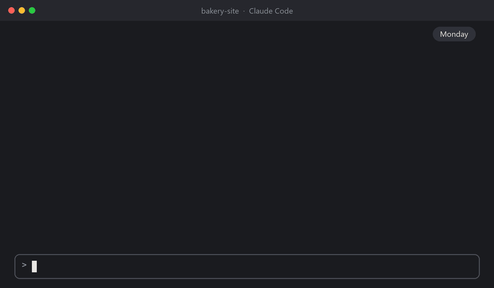

# project-memory

**Helps Claude remember your work from one conversation to the next.**

project-memory is a free add-on (a "plugin") for Claude Code. Once it's
installed, it works on its own in the background. You don't have to learn any
commands to get the benefit.



*The demo replays three real conversations in a sample project, with the
messages shortened to fit.*

## Quick start

With Node.js 20 or newer and Git on your computer, type these two lines in
Claude Code, then restart it:

```
/plugin marketplace add zdraveski/project-memory
/plugin install project-memory@project-memory
```

The [step-by-step install](#install) explains each step and what you need
first.

## What you get

Every new conversation in Claude Code starts fresh. To carry things over,
Claude Code keeps a notebook for each project (it calls this *auto memory*),
where Claude writes down your preferences, decisions and corrections.
project-memory looks after that notebook.

| Without project-memory | With project-memory |
|---|---|
| You start a new conversation and explain again where you were. | Claude starts already knowing where the last conversation stopped. |
| The notebook's table of contents keeps growing, until Claude stops reading the newest notes. | The table of contents stays short, so Claude reads all of it. Older notes move to an archive that Claude can still search. |
| A very long conversation gets shortened, and the task Claude was in the middle of gets lost. | Claude saves its notes before that happens, and afterwards it's told what it was in the middle of. |
| A note deleted or overwritten by mistake is gone for good. | Every version of every note is kept. Ask Claude, and it brings one back. |
| You teach Claude how you like to work again in every project. | Lessons that apply everywhere are shared with all your projects. |
| Two Claude windows on the same project can overwrite each other's notes. | No window overwrites another's notes, and each new conversation is told what the other windows are doing. |

It runs on its own after every reply, with no waiting you'd notice, and
everything stays on your computer.

## Who it's for

project-memory helps most if you:

- come back to the same project over days or weeks,
- give Claude long tasks,
- keep more than one Claude window open,
- or work on several projects and want Claude to know your habits in all of
  them.

If you only ask Claude the occasional one-off question, you won't notice much
difference.

## A week with project-memory

- **Monday.** You tell Claude the bakery's cake prices, and that orders come
  by phone. Claude writes it down.
- **Tuesday.** You start a new conversation and ask *"Where did we leave
  off?"* Claude already knows.
- **Wednesday.** A big task runs so long that Claude Code shortens the
  conversation. Claude saved its notes first, and it's told what it was in the
  middle of, so it can carry on.
- **Thursday.** A note gets deleted by mistake. You ask Claude to bring it
  back, and it does.
- **Friday.** You open a different project. Claude already knows you like
  short, plain answers, because you shared that lesson with all your projects.

## Long conversations and compaction

Claude has a limited amount of room for a conversation, like a desk that only
holds so many papers. Everything has to fit on it: your messages, its replies,
and everything it has read or run along the way. This room is called the
*context window*.

When a conversation nearly fills the context window, Claude Code makes room on
its own. It replaces the older part of the conversation with a short summary,
then carries on. This is called *auto-compaction*. You can also do it yourself
at any time by typing `/compact`.

A summary keeps the gist, but details get lost. And because Claude Code checks
for room before every step, it can compact in the middle of a task. Claude may
then forget a background job it was waiting for, a change it was about to
save, or the notes it meant to write when it finished.

project-memory protects your work before, during and after:

1. **Before.** When a conversation is about 85% full, Claude is asked once to
   write its notes, so what's worth keeping is saved before any summary is
   made. When you type `/compact` yourself, the notes are tidied and the
   record of where you are is saved first.
2. **During.** If Claude Code starts to compact in the middle of a task,
   project-memory asks it to wait until Claude finishes what it's doing and
   hands back to you, when there's still room to wait. Claude Code doesn't
   always agree.
3. **After.** If a task is cut off anyway, Claude is told straight away what it
   was in the middle of: what you asked, what it last said, any background
   jobs still running, and the files it had changed.

Long tasks keep their thread, you don't have to explain things again after a
summary, and Claude is less likely to redo work it had already started.

The reminder at 85% assumes a large context window of 1,000,000 tokens (a
token is about three quarters of a word). If yours is smaller, the reminder
needs one setting to fire. See [Compaction](docs/how-it-works.md#compaction).

## Good to know

- **Your existing notes.** The first time it runs, project-memory may move
  older lines from the table of contents to the archive. Nothing is deleted,
  Claude can still find those notes, and every change is in the history.
- **What it costs.** Each conversation starts with a short briefing, usually
  under 1,000 tokens: about half a percent of a 200,000-token context window.
  In return, the table of contents Claude reads at every start stays under
  7,000 characters. Claude Code allows up to 25,000.
- **Where it works.** On Windows, macOS and Linux, wherever Claude Code runs on
  your computer and can find Node.js.
- **One computer.** Your notes and their history stay on the computer they
  were made on. They don't sync to your other computers.
- **Your own files.** project-memory only writes inside Claude Code's own
  folder. It never touches your project's files or your own git repositories.

## How it compares

project-memory isn't the only way to give Claude Code a better memory. This
table compares it with five popular tools, going only by each one's own
documentation on 27 October 2026. "Not stated" means that documentation
doesn't say. These tools change often, so check their pages before you choose.

| | project-memory | [claude-mem](https://github.com/thedotmack/claude-mem) | [Mem0](https://docs.mem0.ai/integrations/claude-code) | [Supermemory](https://github.com/supermemoryai/claude-supermemory) | [Basic Memory](https://github.com/basicmachines-co/basic-memory) | [context-mode](https://github.com/mksglu/context-mode) |
|---|---|---|---|---|---|---|
| What it is | Claude Code plugin | Claude Code plugin | Claude Code plugin | Claude Code plugin | Memory server for many AI apps | Claude Code plugin |
| Main job | Looking after Claude Code's own memory | Recording and summarising sessions | Memory in the cloud | Memory in the cloud | A knowledge base of notes | Saving context window space |
| Where your memories live | Claude Code's own notebook, on your computer | Its own database, on your computer | Mem0's servers | Supermemory's servers | Text files on your computer, or a paid cloud | A database on your computer, cleared after 14 days |
| Account or API key | No | Optional | Required | Required | No, unless you use the paid cloud | No |
| Extra software | Node.js and Git | Node.js, Bun, uv and a background service | Python and Git | Node.js | Python | Node.js |
| Uses an AI model to write memories | No | Yes: your Claude plan, your own key, or its paid service | Yes, on Mem0's side | Yes, on Supermemory's side | No | No |
| How memories are made | Claude writes notes, and your latest exchanges are saved after every reply | Automatically, from everything Claude does | Automatically, from your conversations | Automatically, from your conversations | Claude writes notes when asked | Automatically, from what happens in a session |
| Search | By words | By words and by meaning | By meaning | By meaning | By words and by meaning, plus links between notes | By words |
| Picks up where you left off | Yes | Yes | Brings back up to 5 memories at the start | Searches memory on every message | When Claude reads the notes | Yes |
| Protects work when a conversation is compacted | Before, during and after | Not stated | Not stated | Not stated | Not stated | Yes |
| Every version kept, so you can undo | Yes | Not stated | Not stated | Not stated | Paid cloud only | No |
| Lessons shared across your projects | Yes | Not stated | No, kept per repository | A personal profile | Yes, one knowledge base | Search across projects |
| Shared with a team | No | Optional | Yes | Yes | Not stated | No |
| Safe with several windows open | Yes, and each window is told about the others | Not stated | Not stated | Not stated | Not stated | Not stated |
| Sends your data anywhere | No | To the AI service you pick | To Mem0, plus usage data tied to your account | To Supermemory | No, unless you use the paid cloud | No |
| Works outside Claude Code | No | Yes | Through other Mem0 integrations | Shares memory with Codex and OpenCode | Yes: Claude Desktop, Cursor, ChatGPT, Obsidian and more | Yes |
| License | MIT | Apache-2.0 | Apache-2.0 | MIT | AGPL-3.0 | Elastic License 2.0 |

In plain words:

- **project-memory** suits you if you want Claude Code's own memory kept
  tidy, safe from mistakes and intact through long conversations, with nothing
  to sign up for and nothing leaving your computer. It searches by words only,
  works in Claude Code only, and doesn't sync between computers or teammates.
- **claude-mem** records everything Claude does and searches it by meaning. It
  runs a background service, and an AI model writes its summaries, which uses
  your Claude plan, your own key or its paid service.
- **Mem0** and **Supermemory** keep memory in the cloud, so it can be shared
  with a team and with other tools. Both need an account, and your
  conversations are sent to their servers.
- **Basic Memory** builds a knowledge base of readable text files that many AI
  apps can use. Claude adds notes when you ask it to, rather than on its own.
- **context-mode** mainly keeps long tool output out of the context window.
  Its session memory is a bonus. It does a different job, and it runs fine
  alongside project-memory.

## Before you install

You need three things. If you already use Claude Code, you probably have
them.

1. Claude Code, with its built-in memory switched on. It's on unless you
   turned it off. To check, type `/memory` in Claude Code.
2. Node.js 20 or newer. This free program is what runs project-memory.
3. Git. This free program keeps the history of your notes. Without it,
   everything works except bringing back old versions of a note.

If you're not sure about the last two, ask Claude: *"Do I have Node.js 20 or
newer, and Git?"* Claude will check for you. If one is missing, download it from
[nodejs.org](https://nodejs.org) (choose the LTS version) or
[git-scm.com](https://git-scm.com).

## Install

1. In Claude Code, type this line and press Enter:

   ```
   /plugin marketplace add zdraveski/project-memory
   ```

2. Then type this one and press Enter:

   ```
   /plugin install project-memory@project-memory
   ```

3. Close Claude Code and open it again.

4. Check that it's working by typing:

   ```
   /project-memory:memory doctor
   ```

   Every line should start with `ok`. Until Claude finishes its first reply,
   one of them says it's waiting for that reply, which is normal. A line that
   starts with `PROBLEM` says what to do about it. See
   [If something seems wrong](#if-something-seems-wrong).

## Using it day to day

There's nothing you have to do. Keep working with Claude as you always have.

When you want something from your notes, just ask in your own words:

| You say | What happens |
|---|---|
| *"Remember that I prefer short answers."* | Claude saves a note. |
| *"Where did we leave off?"* | Claude reads the record of your last conversation. |
| *"Did we decide anything about the logo?"* | Claude searches your notes, including the archive. |
| *"I deleted the note about pricing by mistake. Can you bring it back?"* | Claude restores it from the history. |
| *"Make the note about short answers apply to all my projects."* | Claude asks you to confirm, then moves it to the shared notebook. |
| *"Remember for all my projects that I like plain language."* | Claude saves it straight to the shared notebook. |

If you'd rather type a command, these do the same things:

| Type | What it does |
|---|---|
| `/project-memory:memory status` | A quick health check of this project's notes |
| `/project-memory:memory search logo colors` | Finds notes about "logo colors" |
| `/project-memory:memory history pricing` | Shows when the note called "pricing" changed |
| `/project-memory:memory restore pricing` | Brings back the note called "pricing" |
| `/project-memory:memory promote pricing` | Moves the note called "pricing" to the shared notebook |
| `/project-memory:memory doctor` | Checks that project-memory is set up and running |

A note's name is the name of its file, without the `.md` ending. `search`
shows them.

## Updating

In a terminal (Terminal on a Mac, PowerShell on Windows), run these two
commands, then restart Claude Code:

```
claude plugin marketplace update project-memory
claude plugin update project-memory@project-memory
```

What changed in each version is in the [changelog](CHANGELOG.md).

## If something seems wrong

**Claude doesn't remember the last conversation.** Ask *"Where did we leave
off?"* If Claude still doesn't know, type `/project-memory:memory doctor`.

**The check says "not wired".** project-memory isn't installed or isn't
switched on. Go through the [Install](#install) steps again.

**The check says "its Stop hook is not running".** Claude finished a reply,
but project-memory didn't save after it. Restart Claude Code. If the line is
still there after Claude's next reply, ask Claude to check that Node.js is
installed.

**Any other line that starts with `PROBLEM`.** The line ends with what to do.
If it's unclear, ask Claude: *"What does this line mean, and how do I fix it?"*

**A note seems to be gone.** It may have moved to the archive, where it's still
kept. Ask Claude to search for it. If it was deleted, ask Claude to bring it
back.

**"node" is not found.** Install Node.js (see
[Before you install](#before-you-install)), then restart Claude Code.

## Your privacy

- project-memory never connects to the internet. What it saves stays on your
  computer, in Claude Code's own folder (`.claude`, in your home folder).
- Claude reads your notes during your conversations. Claude Code's built-in
  memory works the same way.
- The record of where you left off includes the start of your messages and of
  Claude's replies, and the names of the files Claude changed. The history
  keeps old versions of every note. If you copy or share your `.claude` folder,
  all of that goes with it.
- Keys, tokens and passwords you paste into a message are replaced with
  `[redacted]` before anything is saved. To keep anything else out, put it
  between `<private>` and `</private>`.

The full details are in the [privacy policy](PRIVACY.md).

## Turning it off or removing it

To pause it, run this in a terminal and restart Claude Code. Your notes and
their history stay as they are.

```
claude plugin disable project-memory@project-memory
```

`claude plugin enable project-memory@project-memory` turns it back on.

To remove it, type this in Claude Code:

```
/plugin uninstall project-memory@project-memory
```

Your notes stay where they are, and Claude Code keeps using them. To delete
the history of your notes as well, delete the hidden folder `.git` inside
`.claude/projects` in your home folder.

## Words used here

- **Conversation**: one session with Claude, from when you start it until you
  close or clear it.
- **Note**: a short file where Claude writes down something worth keeping.
  Claude Code calls these *memories*.
- **Notebook**: all of one project's notes, with their table of contents (a
  file called `MEMORY.md`).
- **Archive**: where older lines from the table of contents go. Claude doesn't
  read it at the start of every conversation, but it can search it.
- **Shared notebook**: notes that apply to all your projects. Every
  conversation, in every project, reads its table of contents.
- **History**: every version of every note, kept with Git on your computer.
- **Project**: the folder you open Claude Code in.
- **Context window**: how much of a conversation Claude can keep in view at
  once. Its size is counted in tokens, about three quarters of a word each.
- **Compaction** (or shortening): what Claude Code does when a conversation
  nearly fills the context window. It replaces the older part with a summary.
  When Claude Code does it on its own, it's called *auto-compaction*.
- **Plugin**: an add-on for Claude Code.
- **Terminal**: the app where you type commands: Terminal on a Mac, PowerShell
  on Windows.

## More

- [How it works](docs/how-it-works.md): the technical details, for the curious.
- [Changelog](CHANGELOG.md): what changed in each version.
- [Privacy policy](PRIVACY.md): what it reads and saves, in full.
- [Contributing](CONTRIBUTING.md): running the tests and changing the code.
- Questions or problems: [open an issue](https://github.com/zdraveski/project-memory/issues).
- License: [MIT](LICENSE). Free to use, change and share.
