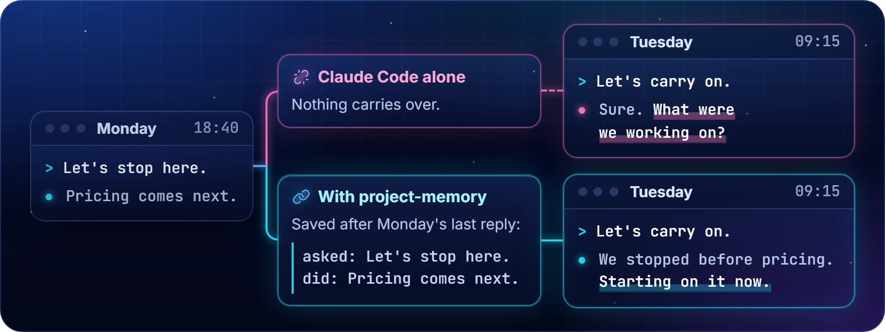
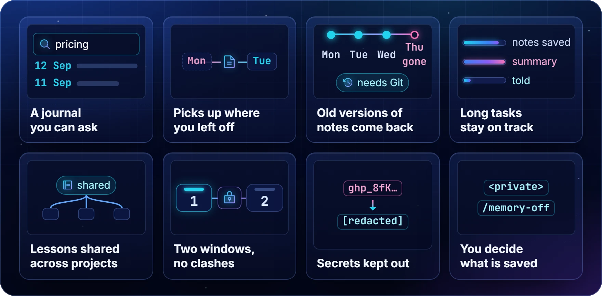

<p><picture>
  <source media="(max-width: 700px)" srcset="docs/banner-narrow.webp">
  
</picture></p>

# project-memory

[Using it](#using-it) · [Install](#install) · [Secrets and privacy](#secrets-stay-out) ·
[Questions](docs/faq.md) ·
[Project page](https://zdraveski.github.io/project-memory/)

[](https://github.com/zdraveski/project-memory/actions/workflows/test.yml)
[](https://github.com/zdraveski/project-memory/releases/latest)
[](LICENSE)
[](#install)

**Gives Claude Code a journal of your work, so a new conversation starts where the last one stopped.**

project-memory is a free add-on (a "plugin", MIT license) for Claude Code, the
coding assistant from Anthropic. Claude Code forgets everything when a
conversation ends. This add-on saves a journal of your work on your own
computer, so the next conversation starts where the last one stopped. It
helps most when you return to the same project over days or weeks. It works on
its own after every reply, and needs no account or API key.

To try it, type these two lines in Claude Code. When the second one opens a
menu, choose to install it for you (user scope), then restart Claude Code. It
needs Node.js 22 or newer; the full steps are under [Install](#install).

```
/plugin marketplace add zdraveski/project-memory
/plugin install project-memory@project-memory
```

It adds a short briefing (about 900 tokens) at the start of a conversation.
What it does after each reply runs outside the conversation, and every step
has a time limit, so a stuck step cannot hold Claude up
([details](docs/faq.md#does-it-slow-claude-down-or-fill-the-conversation)).

<p><picture>
  <source media="(max-width: 700px)" srcset="docs/problem-narrow.webp">
  
</picture></p>

## What you get

Claude Code keeps a notebook of notes for each project (it calls this *auto
memory*). project-memory looks after that notebook and adds a journal of
everything you did.

| Without project-memory | With project-memory |
|---|---|
| Work from a few weeks ago is hard to find again. | Every exchange is kept in a journal on your computer. Ask about earlier work in your own words, and Claude finds it and tells you when it happened. |
| Each new conversation starts from zero. | Claude starts already knowing where the last conversation stopped. |
| A note deleted or overwritten by mistake is gone. | Every version of your notes is kept, and Claude brings an old one back when you ask. |
| Claude Code shortens a very long conversation to a summary, and the task in progress can get lost. | Claude saves its notes first, and afterwards it's told what you asked and what it last said. |
| You teach Claude your habits again in every project. | Lessons that apply everywhere are shared with all your projects. |
| A key or password you paste can end up in saved files. | Keys, tokens and passwords are replaced with `[redacted]` in the journal and the handoff. |
| There is no way to keep a passage or a project out. | You choose: keep a passage out, a conversation, or a whole project. |

For a quick one-off question, you won't notice much difference.

<p><picture>
  <source media="(max-width: 700px)" srcset="docs/what-you-get-narrow.webp">
  
</picture></p>

## Using it

There's nothing to learn. Ask in your own words:

| You say | What happens |
|---|---|
| *"What did we decide about the logo in September?"* | Claude searches your notes and the journal, and answers with the date. |
| *"Where did we leave off?"* | Claude already knows: each new conversation starts with the last one's latest exchanges. |
| *"I deleted the note about pricing by mistake. Bring it back."* | Claude restores it from the history. |
| *"Forget the password I pasted yesterday."* | Claude lists the journal entries that match, and removes the ones you confirm from project-memory's files. Claude Code's own conversation files still hold them. |
| *"Remember for all my projects that I like plain language."* | Claude saves it to the shared notebook. |

If you'd rather type a command, start with `/project-memory:memory`:

| Type | What it does |
|---|---|
| `/project-memory:memory search logo colors` | Finds notes and journal entries about "logo colors". |
| `/project-memory:memory restore pricing` | Brings back the note "pricing" (`history pricing` shows when it changed). |
| `/project-memory:memory doctor` | Checks that project-memory itself works. |
| `/project-memory:incognito`, `/project-memory:memory-off` | Stop saving a conversation, or a project (see [Turning it off](#turning-it-off)). |

All the commands are in [How it works](docs/how-it-works.md#using-it). To read
your notes yourself, type `/memory` in Claude Code and open the auto memory
folder. The journal is its `journal` folder, one file per day. The notebook's
table of contents (`MEMORY.md`) is kept short without dropping a note.

## Install

You need Claude Code with its built-in memory on (it is, unless you turned it
off) and [Node.js](https://nodejs.org) 22 or newer (choose the LTS version).
[Git](https://git-scm.com) is optional: without it, everything works except
bringing back old versions of notes. It works on Windows, macOS and Linux, in
Claude Code only. Not sure? Ask Claude: *"Do I have Node.js 22 or newer, and Git?"*

1. In Claude Code, type these two lines. When the second one opens a menu,
   choose to install it for you (user scope), so it works in every project.

   ```
   /plugin marketplace add zdraveski/project-memory
   /plugin install project-memory@project-memory
   ```

2. Close Claude Code and open it again.
3. Type `/project-memory:memory doctor`. Every line should start with `ok`.
   Until Claude finishes its first reply, one line says it's waiting for
   that reply, which is normal.

### Updating

In a terminal, run these two commands (or ask Claude to), then restart Claude
Code. Only the newest version gets fixes ([Supported versions](SECURITY.md#supported-versions));
what changed is in the [changelog](CHANGELOG.md).

```
claude plugin marketplace update project-memory
claude plugin update project-memory@project-memory
```

### Pausing or removing it

To pause it, run `claude plugin disable project-memory@project-memory` in a
terminal and restart Claude Code; `enable` turns it back on. To remove it,
type `/plugin uninstall project-memory@project-memory` in Claude Code. Your
notes, the journal and the history stay either way. What to delete by hand:
[Deleting it](PRIVACY.md#deleting-it).

## Secrets stay out

Before project-memory saves to the journal or the handoff (the short record of
where you stopped), it replaces secrets with `[redacted]`: keys and tokens
from many services, passwords in commands and chat (in several languages),
cookies and look-alike spellings of these.

<p><picture>
  <source media="(max-width: 700px)" srcset="docs/secrets-narrow.webp">
  
</picture></p>

A note that holds a secret is kept out of history snapshots. **No tool catches
every secret:** put anything else between `<private>` tags. Details:
[How it works](docs/how-it-works.md#the-handoff), [privacy policy](PRIVACY.md).

## Your privacy

<p><picture>
  <source media="(max-width: 700px)" srcset="docs/privacy-narrow.webp">
  
</picture></p>

- project-memory never goes online. What it saves stays in Claude Code's own
  folder (`.claude`, in your home folder). What Claude reads during a
  conversation goes to Anthropic with the rest of it, as with Claude Code's
  own memory.
- The journal keeps each exchange whole: your message, Claude's reply, every
  file it changed and every command it ran, until you delete it or ask Claude
  to forget part of it.
- Put text between `<private>` and `</private>` to keep it out. Type
  `<private-session>` in any message to keep the whole conversation out; what
  was saved of it before is removed, except the history's copy of days
  already over.
- *"Forget …"* removes the journal entries you confirm. A copy of days that are
  already over stays in the history unless you use `forget --purge`.

Everything it reads and saves, and how to delete it: [privacy policy](PRIVACY.md).

### Turning it off

Four ways, from narrow to wide:

<p><picture>
  <source media="(max-width: 700px)" srcset="docs/turning-off-narrow.webp">
  
</picture></p>

1. **One conversation:** `/project-memory:incognito`. If it says `NOT applied`,
   it did not work.
2. **One project:** `/project-memory:memory-off`, and `/project-memory:memory-on`
   to come back.
3. **All projects on this computer:** set `CLAUDE_CODE_DISABLE_AUTO_MEMORY` to `1`, or
   disable the plugin.
4. **Claude Code itself:** its own settings, which project-memory does not read
   or change.

None of these reaches Claude Code's own files: by default it still keeps its
own transcript of every conversation, for 30 days unless you change that.
What each level does and does not touch is in
[How it works](docs/how-it-works.md#turning-it-off).

## Long conversations

When a conversation gets very long, Claude Code shortens it to a summary and
details can be lost. project-memory has Claude save its notes before that, and
afterwards tells Claude what you asked and what it last said.

<p><picture>
  <source media="(max-width: 700px)" srcset="docs/long-conversations-narrow.webp">
  
</picture></p>

One setting matters if your model holds 200,000 tokens (a token is a small
piece of a word): see
[If your model holds 200,000 tokens](docs/how-it-works.md#if-your-model-holds-200000-tokens).
The other tuning is in [Compaction](docs/how-it-works.md#compaction).

## Checked lessons (experimental)

A note can carry a rule for a git command, such as "don't run `git add -A`".
Add an `enforce:` block to the note's front matter, indented two spaces:

```
enforce:
  on: git add
  has: [-A, --all, .]
  unless: [mktemp, init]
```

A hook then watches your git calls and logs which note matched. It only
watches and logs: it blocks nothing and prints nothing. Few lessons fit this
form, and some commands it does not see. This is a test of the idea, not a
promise. Syntax, limits and how to try a rule on past conversations:
[Checked lessons](docs/how-it-works.md#checked-lessons-experimental).

## Security and trust

Every change is tested on Windows, macOS and Linux before it is released, and
the code is scanned for problems weekly. How releases are verified:
[Verifying a release](SECURITY.md#verifying-a-release). The risks are written
down in the [Security assessment](docs/security-assessment.md). Report a
security or privacy problem privately, as [SECURITY.md](SECURITY.md) says; you
get an answer within a week.

[](https://scorecard.dev/viewer/?uri=github.com/zdraveski/project-memory)
[](https://www.bestpractices.dev/projects/16158)
[](https://www.bestpractices.dev/projects/16158/baseline-2)

## If something seems wrong

Type `/project-memory:memory doctor`. A line that starts with `PROBLEM` says
what to do; if `node` is not found, install Node.js and restart Claude Code.
What each message means:
[When something seems wrong](docs/how-it-works.md#when-something-seems-wrong).

## Compared with other tools

Claude Code's own memory keeps no journal, no history of your notes and no
shared notebook. project-memory adds those, with nothing leaving your
computer. It searches by words, not by meaning, and works in Claude Code only.
[Comparison](docs/comparison.md) has the side-by-side.

## More

- [Project page](https://zdraveski.github.io/project-memory/): the short tour.
- [Questions people ask](docs/faq.md) and [How it works](docs/how-it-works.md):
  short answers, and the technical details.
- [Privacy policy](PRIVACY.md), [Contributing](CONTRIBUTING.md),
  [Governance](GOVERNANCE.md), [License](LICENSE) (MIT).
- Ask in [Discussions](https://github.com/zdraveski/project-memory/discussions),
  report a problem as an [issue](https://github.com/zdraveski/project-memory/issues);
  where to ask what: [Support](SUPPORT.md).
- From the same author: [claude-juice](https://github.com/zdraveski/claude-juice)
  shows your Claude Code usage limits as batteries in the status line.
