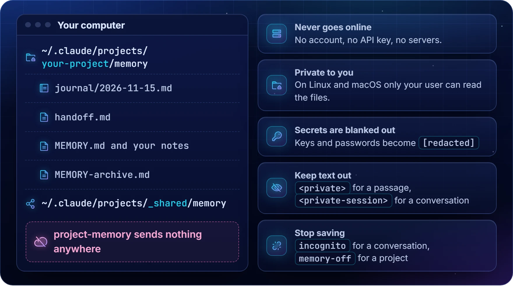
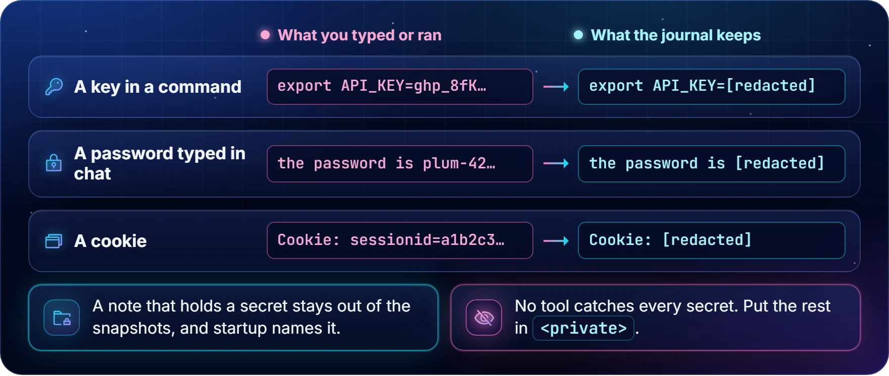
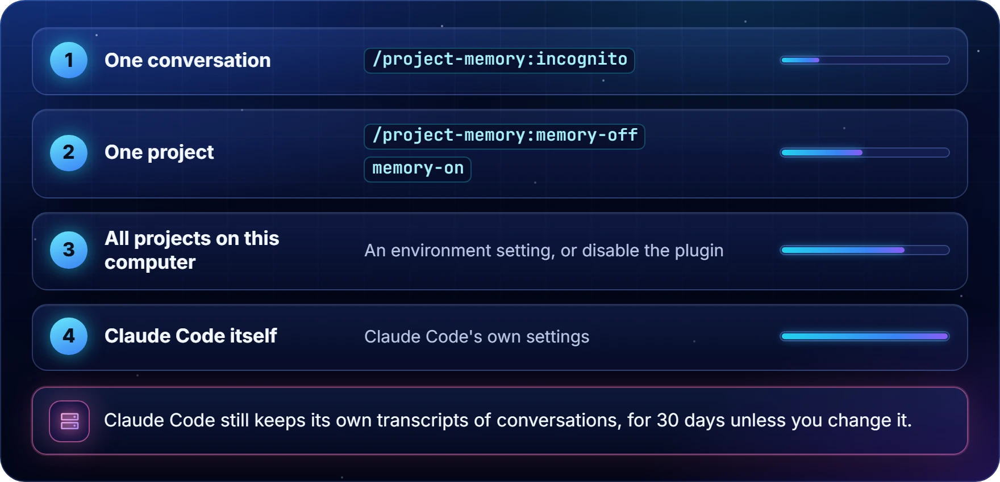
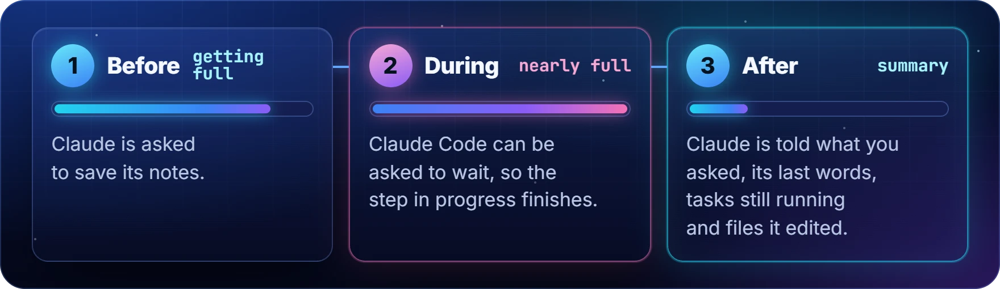

<div align="center">

<picture>
  <source media="(max-width: 700px)" srcset="docs/banner-narrow.webp">
  
</picture>

# project-memory

**Claude Code forgets. project-memory remembers.**<br>
Saved only on your computer.

[](https://github.com/zdraveski/project-memory/actions/workflows/test.yml)
[](https://github.com/zdraveski/project-memory/releases/latest)
[](LICENSE)
[](#install)

[Install](#install) · [Using it](#using-it) · [Privacy](#privacy-and-control) ·
[Questions](docs/faq.md) · [Project page](https://zdraveski.github.io/project-memory/)

</div>

Claude Code forgets everything when a conversation ends. project-memory is a
free, local [persistent memory plugin for Claude Code](https://zdraveski.github.io/project-memory/)
(MIT license) that keeps a journal of your work on your own
computer, so the next conversation starts where the last one stopped. It runs
on its own after every reply, and it helps most when you come back to the
same project over days or weeks.

Two lines in Claude Code install it. When the second one opens a menu, choose
to install it for you (user scope), then restart Claude Code:

```
/plugin marketplace add zdraveski/project-memory
/plugin install project-memory@project-memory
```

It needs [Node.js](https://nodejs.org) 22 or newer, and no account or API key.
A new conversation starts with a short briefing (it names your last session
if it was in the last 30 days) of about 900 tokens, never
more than about 2,400. Its work runs after each reply, with a time limit on
every step, so a stuck step can't hold Claude up
([details](docs/faq.md#does-it-slow-claude-down-or-fill-the-conversation)).

<p><picture>
  <source media="(max-width: 700px)" srcset="docs/problem-narrow.webp">
  
</picture></p>

## What you get

Claude Code keeps a notebook of notes for each project (it calls this *auto
memory*). project-memory looks after that notebook and adds a journal of
everything you did.

| Claude Code alone | With project-memory |
|---|---|
| Each new conversation starts from zero. | **Picks up where you left off.** Claude starts already knowing where the last conversation stopped. |
| Work from a few weeks ago is hard to find again. | **A journal you can ask.** Every exchange is kept on your computer. Ask in your own words, and Claude finds it and tells you when it happened. |
| A note deleted or overwritten by mistake is gone. | **Old versions come back.** Every version of your notes is kept, and Claude restores one when you ask. |
| A very long conversation is shortened to a summary, and the task in progress can get lost. | **Long tasks stay on track.** Claude saves its notes first, and afterwards it's told what you asked and what it last said. |
| Habits that hold everywhere go in a CLAUDE.md in your home folder, kept by hand. | **Lessons shared across projects.** What applies everywhere goes in a notebook every project reads. |
| Two windows open on one project can clash. | **Two windows are safe to use.** Each store has a lock. A hook waits up to 2 seconds for it, skips that part if it is still busy, and catches up after the next reply. |
| A key or password you paste can end up in saved files. | **Secrets kept out.** Keys, tokens and passwords become `[redacted]` before they reach the journal or the handoff. |
| There is no way to keep a passage or a project out. | **You decide what is saved.** Keep out a passage, a conversation or a whole project. |

<p><picture>
  <source media="(max-width: 700px)" srcset="docs/what-you-get-narrow.webp">
  
</picture></p>

## Using it

There's nothing to learn. Ask in your own words:

| You say | What happens |
|---|---|
| *"Where did we leave off?"* | Claude already knows: each new conversation starts with the last one's latest exchanges. |
| *"What did we decide about the logo in September?"* | Claude searches your notes and the journal, and answers with the date. |
| *"Why did we drop the PDF export, and who asked for it?"* | A question one search doesn't settle goes to the `recall` helper, which searches several ways and reports back with dates and your own words (`@agent-project-memory:recall` asks it directly). Its report is not saved again to the journal. |
| *"I deleted the note about pricing by mistake. Bring it back."* | Claude restores it from the history. |
| *"Forget the password I pasted yesterday."* | Claude lists the journal entries that match, and removes the ones you confirm from project-memory's files. Claude Code's own conversation files still hold them. |
| *"Remember for all my projects that I like plain language."* | Claude saves it to the shared notebook. |

If you'd rather type a command, start with `/project-memory:memory`:

| Type | What it does |
|---|---|
| `/project-memory:memory search logo colors` | Finds notes and journal entries about "logo colors". |
| `/project-memory:memory search --file cart.js` | Lists the entries that changed that file. `--asked` searches only your own words, `--conversation <id>` one session. |
| `/project-memory:memory restore pricing` | Brings back the note "pricing" (`history pricing` shows when it changed). |
| `/project-memory:memory history pricing` | Shows when the note "pricing" changed, and which exchange (what you asked) was behind each change. |
| `/project-memory:memory page` | Writes your journal as one web page on your computer, a week at a time, and prints its link. `--days N` or `--days all` sets how far back (30 by default), `--project NAME` picks one project. |
| `/project-memory:memory doctor` | Checks that project-memory itself works. |
| `/project-memory:incognito`, `/project-memory:memory-off` | Stop saving a conversation, or a project (see [Turning it off](#turning-it-off)). |

<p></p>

To read your notes yourself, type `/memory` in Claude Code and open the auto
memory folder; the journal is its `journal` folder, one file per day. Every
command is in [How it works](docs/how-it-works.md#using-it).

## Install

You need:

- **Claude Code 2.1.78 or newer**, with its built-in memory on. It is, unless
  you turned it off. The `recall` helper needs 2.1.271 or newer to start
  without your CLAUDE.md files; older versions run it with CLAUDE.md loaded.
- **[Node.js](https://nodejs.org) 22 or newer.** Choose the LTS version.
- **[Git](https://git-scm.com), optional.** Without it, everything works except
  bringing back old versions of notes.

It works on Windows, macOS and Linux, in Claude Code only. Not sure what you
have? Ask Claude: *"Do I have Node.js 22 or newer, and Git?"*

1. In Claude Code, type these two lines. When the second one opens a menu,
   pick the option that installs it for you in every project (it may say user
   scope).

   ```
   /plugin marketplace add zdraveski/project-memory
   /plugin install project-memory@project-memory
   ```

2. Close Claude Code and open it again.
3. Type `/project-memory:memory doctor`. No line should start with `PROBLEM` (`note` lines are allowed states, such as no Git installed).
   Until Claude finishes its first reply, one line says it's waiting for
   that reply, which is normal.

### Updating

In a terminal, run these two commands (or ask Claude to), then restart Claude
Code. Only the newest version gets fixes ([Supported versions](SECURITY.md#supported-versions));
what changed is in the [changelog](CHANGELOG.md).

```
claude plugin marketplace update project-memory
claude plugin update project-memory@project-memory
```

A marketplace you add yourself has auto-update off, so new versions do not
arrive on their own. To turn it on, type `/plugin` in Claude Code, open
Marketplaces, choose project-memory and select Enable auto-update.
`/project-memory:memory doctor` says whether it is on.

### Pausing or removing it

To pause it, run `claude plugin disable project-memory@project-memory` in a
terminal and restart Claude Code; `enable` turns it back on. To remove it,
type `/plugin uninstall project-memory@project-memory` in Claude Code. Your
notes, the journal and the history stay either way (so does the journal page, if you made one). What to delete by hand:
[Deleting it](PRIVACY.md#deleting-it).

## Privacy and control

<p><picture>
  <source media="(max-width: 700px)" srcset="docs/privacy-narrow.webp">
  
</picture></p>

### Stays on your computer

- **project-memory never goes online.** What it saves stays in Claude Code's
  own folder (`.claude`, in your home folder). What Claude reads during a
  conversation goes to Anthropic with the rest of it, as with Claude Code's
  own memory.
- **The journal keeps each exchange whole:** your message, everything Claude
  wrote in the turn, every file it changed and every command it ran (up to
  20,000 characters for one command and 50,000 for a turn, newest first), and your pick when you answer one of
  its multiple-choice questions, until you delete it or ask Claude to forget
  part of it. The code Claude runs through context-mode's ctx_execute or ctx_batch is kept
  with the commands, the last 300 characters of an error that was never fixed
  are kept after its command, and what a subagent reports back is kept as its
  own entry (up to 8,000 characters), with the files it changed. A subagent's
  entry saved before 1.6.0 lists no files. All of it passes the secret filter
  first. Entries saved before 1.5.0 are not rewritten, but you can rebuild
  them: once per store, delete `journal/.imported` and `journal/.looked`. The
  next replies read your transcripts again and redact under the newer rules.
  This only works for conversations whose transcript is still on disk (Claude
  Code keeps them 30 days unless you change that); older entries stay as
  saved. Forgotten entries stay gone and private conversations stay swept.
- **The journal page** (`memory page`) is one HTML file, `project-memory/journal.html`
  in Claude Code's folder, readable only by you. It holds the same text as the
  journal, with secrets already replaced, and loads nothing from the network:
  no script or picture from outside, and a policy in the file that forbids it.
  Private turns show no text, and helper entries and switched-off projects are
  left out. Forgetting, incognito, turning a project off and `rescan --apply`
  delete it; run `memory page` again for a fresh one.
- **Keep text out** by putting it between `<private>` and `</private>`. Type
  `<private-session>` in any message to keep the whole conversation out; what
  was saved of it before is removed, except the history's copy of days
  already over.
- ***"Forget …"*** removes the journal entries you confirm. A copy of days that
  are already over stays in the history unless you use `forget --purge`.

Everything it reads and saves, and how to delete it: [privacy policy](PRIVACY.md).

### Secrets stay out

Before project-memory saves to the journal or the handoff (the short record of
where you stopped), it replaces secrets with `[redacted]`: keys and tokens
from many services, passwords in commands and chat (in several languages),
cookies, and look-alike spellings of these. A note that holds a secret is kept
out of history snapshots. A secret saved before a rule for it existed is found
by `/project-memory:memory rescan`, which counts first and changes nothing
until you add `--apply --yes`.

<p><picture>
  <source media="(max-width: 700px)" srcset="docs/secrets-narrow.webp">
  
</picture></p>

**No tool catches every secret:** put anything else between `<private>` tags.
Details: [How it works](docs/how-it-works.md#the-handoff).

### Turning it off

Four ways, from narrow to wide:

1. **One conversation:** `/project-memory:incognito`. If it says `NOT applied`,
   it did not work.
2. **One project:** `/project-memory:memory-off`, and `/project-memory:memory-on`
   to come back.
3. **All projects on this computer:** set the environment variable `CLAUDE_CODE_DISABLE_AUTO_MEMORY` to `1`
   (for example in the `env` block of Claude Code's `settings.json`), or disable
   the plugin.
4. **Claude Code itself:** its own `autoMemoryEnabled: false` setting also turns
   project-memory off; it reads that one value and changes nothing.

To turn off only the startup briefing, set `PROJECT_MEMORY_BRIEFING` to `0`.
Everything else keeps saving.

**Pointers to earlier exchanges (opt-in).** The two notes below (a file with
a past, a request that names something old) and the briefing's line that hands
a hard question about the past to the `recall` helper are off by default: they
are not yet measured, and a note that does not help costs words in every
conversation. To turn them on, set `PROJECT_MEMORY_RECALL` to `1`, for example
in the `env` block of Claude Code's `settings.json`:

```json
{ "env": { "PROJECT_MEMORY_RECALL": "1" } }
```

Without it, sessions that see each other and the list after a compaction keep
working, and you can still ask the helper by name (`@agent-project-memory:recall`).
`PROJECT_MEMORY_RECALL=0` turns all of it off.

**A file with a past (opt-in).** When Claude changes a file that earlier conversations
in this project changed too, and one of them shares a rare word with your
current request, it is told so with the result of that first change: the date, the conversation and the request of the newest two, and how
to open them. Once per file and conversation, at most three such notes between
two of your messages, never from a private or forgotten exchange. After a
compaction, Claude is also told which files the conversation changed and up to
three earlier exchanges that share rare words with the request in progress,
its own from before the compaction included (on by default). Set
`PROJECT_MEMORY_RECALL` to `0` to turn these notes off. A note already shown
stays in the conversation that got it: `forget` cannot take it back. A
helper's changes before 1.6.0 have no past (its entries listed no files then).

**A request that names something old (opt-in).** When your message shares three rare
words (one in five of its words, when that is more; two, for a message of two
words) with an earlier exchange of another
conversation in this project, Claude is told so before it answers: the
request, up to three files it changed, the shared words, and how to open it.
A word is rare when fewer than 1 in 20 recent exchanges hold it. At most three
such exchanges, each once per conversation; "go" or "yes" alone never
triggers one, nor a file note. A message with a `<private>` block or the `<private-session>`
mark triggers none and is not written down. `PROJECT_MEMORY_RECALL=0` turns
this off too.

**Sessions that see each other.** Two Claude Code sessions open on the same
project know about each other. At your next message, Claude is told once that
another session is working here, since when, on what request and which files
it changed:

```
project-memory: another session [9a1c22e0] is working in this project since 14:02 on: "move the export to 02:00". Files it changed: src/closeDay.js
```

When Claude changes a file the other session changed in the last 30 minutes,
the warning comes with the result of that change (it never blocks it):

```
project-memory: another session [9a1c22e0] changed this file at 14:02 (its request: "move the export to 02:00"). Check with the user or that session before changing it again.
```

The startup briefing and `memory status` name the other live sessions too,
with the title you gave one (`/rename`). A session counts as live for 30
minutes after its last message or change, and until it ends (a SessionEnd
hook marks that). A file in another worktree is another file. A private
conversation or turn is never shown to the other session.
`PROJECT_MEMORY_RECALL=0` turns these lines off too.

To know what it has said, each conversation keeps a small file in
`~/.claude/projects/.sessions/`, deleted after 7 days.

Each hook run also leaves one line of numbers (when, which hook, how many
milliseconds) in `~/.claude/projects/.timing`, and `memory doctor` shows the
times. Set `PROJECT_MEMORY_TIMING=0` to turn that off.

<p><picture>
  <source media="(max-width: 700px)" srcset="docs/turning-off-narrow.webp">
  
</picture></p>

None of these reaches Claude Code's own files: by default it still keeps its
own transcript of every conversation, for 30 days unless you change that.
What each level does and does not touch is in
[How it works](docs/how-it-works.md#turning-it-off).

## Long conversations

When a conversation gets very long, Claude Code shortens it to a summary and
details can be lost. project-memory has Claude save its notes before that, and
afterwards tells Claude what you asked and what it last said.

<p><picture>
  <source media="(max-width: 700px)" srcset="docs/long-conversations-narrow.webp">
  
</picture></p>

**If your model holds 200,000 tokens, one setting matters** (a token is a
small piece of a word): see
[If your model holds 200,000 tokens](docs/how-it-works.md#if-your-model-holds-200000-tokens).
If you use a gateway or a model that is not a Claude model, also set
`CLAUDE_CODE_MAX_CONTEXT_TOKENS` to its real window and `ANTHROPIC_MODEL` to its id, or the plugin assumes
1,000,000 tokens. The wait in the middle only happens when Claude Code compacts at 200,000
tokens or more and under 90% of the model's window: a compaction window of
about 233,000 to 933,000 tokens on a 1M model. Outside that range the
compaction goes ahead, and the note afterwards does the work. The rest of
the tuning is in [Compaction](docs/how-it-works.md#compaction).

## What runs, and when

project-memory is a set of hooks: small programs Claude Code starts on its
own events. Each one gives up quietly if something goes wrong, so it never
blocks your work.

| When | What it does |
|---|---|
| Claude finishes a reply (or stops on an error) | Saves the exchange to the journal and the handoff, tidies `MEMORY.md`, takes a snapshot of your notes. |
| A helper agent finishes | Saves its report and the files it changed as its own journal entry. |
| A conversation starts, is cleared or is compacted | Prints the startup briefing. After a compaction it also names the files the conversation changed and earlier exchanges like the request in progress. |
| You send a message | Names an earlier exchange your message points to, and another session working here. |
| Claude changes a file | Names an earlier exchange that changed the same file, and warns when another session just changed it. |
| A conversation ends | Marks it ended, so other sessions stop counting it as live. |
| Claude runs a `git` command | Logs which checked lesson it matched. Blocks nothing. |
| Before a compaction | Saves first, and may ask Claude Code to wait for the turn to end. |

**It stays light.** The save after a reply takes about a quarter of a second
of the plugin's own time, and the briefing under two tenths. Most of the time
a hook takes is spent outside the plugin's own code. In 1.6.0 the `memory`
skill Claude loads is 68% smaller, and the briefing 3 to 12% smaller (the
shared notebook's index and the rules stay whole on purpose).

Every hook and its limits: [When it runs](docs/how-it-works.md#when-it-runs).

## Compared with other tools

Claude Code's own memory doesn't keep a journal, a history of your notes or a
shared notebook. project-memory adds those, and keeps what it saves on your computer, with
no server of its own. What Claude reads of it goes to Anthropic with the rest
of the conversation. Claude Code's `/resume` reopens one earlier conversation with its
whole history; project-memory starts a fresh one with a short briefing, and
its journal covers every conversation you don't keep private, not only the one
you reopen.
[Comparison](docs/comparison.md) puts it side by side with claude-mem, Mem0,
Supermemory and others.

## Good to know

- **For a quick one-off question, you won't notice much difference.** It earns
  its keep when you come back to a project.
- **Search goes by words, not by meaning.** It matches other forms of a word
  (`migrated` finds `migration`, in English and Macedonian), not synonyms.
- **It works in Claude Code only**, and each computer keeps its own memory:
  nothing syncs between computers or teammates.
- **It tidies Claude's table of contents** (`MEMORY.md`) so it stays short
  without dropping a note. Your index lines stay; your own headings don't.
  It does not follow a memory folder moved with `autoMemoryDirectory`. See
  [Good to know](docs/how-it-works.md#good-to-know).

## Checked lessons (experimental)

A note can carry a rule for a git command, such as "don't run `git add -A`".
Add an `enforce:` block to the note's front matter, indented two spaces:

```
enforce:
  on: git add
  has: [-A, --all, .]
  unless: [mktemp, init]
```

A hook then watches your git calls and logs which note matched. It only
watches and logs: it blocks nothing and prints nothing. Few lessons fit this
form, and some commands it does not see. It is a 30-day trial (see the changelog for the end date). The author checks
`memory enforce status` (hits per rule in the last 30 days) and keeps or cuts it.
Syntax, limits and how to try a rule on past conversations:
[Checked lessons](docs/how-it-works.md#checked-lessons-experimental).

## Security and trust

Every change is tested on Windows, macOS and Linux before it is released, and
the code is scanned for problems weekly. How releases are verified:
[Verifying a release](SECURITY.md#verifying-a-release). The risks are written
down in the [Security assessment](docs/security-assessment.md). Report a
security or privacy problem privately, as [SECURITY.md](SECURITY.md) says; you
get an answer within a week.

[](https://scorecard.dev/viewer/?uri=github.com/zdraveski/project-memory)
[](https://www.bestpractices.dev/projects/16158)
[](https://www.bestpractices.dev/projects/16158/baseline-2)

## If something seems wrong

Type `/project-memory:memory doctor`. A line that starts with `PROBLEM` says
what to do; if `node` is not found, install Node.js and restart Claude Code.
What each message means:
[When something seems wrong](docs/how-it-works.md#when-something-seems-wrong).

## More

- [Project page](https://zdraveski.github.io/project-memory/): the short tour.
- [Documentation](docs/README.md): [questions people ask](docs/faq.md),
  [how it works](docs/how-it-works.md) and the [comparison](docs/comparison.md).
- [Privacy policy](PRIVACY.md), [Contributing](CONTRIBUTING.md),
  [Governance](GOVERNANCE.md), [License](LICENSE) (MIT).
- Ask in [Discussions](https://github.com/zdraveski/project-memory/discussions),
  report a problem as an [issue](https://github.com/zdraveski/project-memory/issues);
  where to ask what: [Support](SUPPORT.md).
- From the same author: [claude-juice](https://github.com/zdraveski/claude-juice)
  shows your Claude Code usage limits as batteries in the status line.
